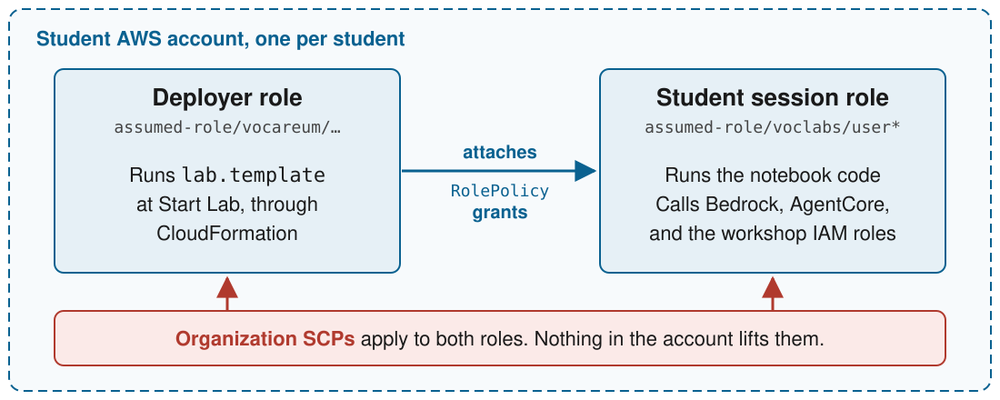

<style>
section {
  --marp-auto-scaling-code: false;
  font-size: 28px;
  padding: 56px 72px;
}

h1 {
  color: #0a6190;
}

h2 {
  color: #0a6190;
  font-size: 40px;
}

code {
  font-size: 0.9em;
}

table {
  font-size: 22px;
}

/* Disable all fragment animations */
li,
.marp-fragment {
  opacity: 1 !important;
  animation: none !important;
  visibility: visible !important;
}

/* Title and closing slides. */
section.lead {
  justify-content: center;
}

section.lead h1 {
  font-size: 64px;
  margin-bottom: 0;
}

section.lead p.subtitle {
  font-size: 32px;
  color: #444;
}

/* A slide with a long table or many lines. */
section.dense {
  font-size: 24px;
}

section.dense table {
  font-size: 20px;
}

section.dense pre {
  font-size: 18px;
}
</style>

<!-- _class: lead -->
<!-- _paginate: false -->

# Neo4j Courses on Vocareum

<p class="subtitle">Overview of Neo4j Courses on Vocareum and Built Utils</p>

**Ryan Knight**, Neo4j. 

Co-presented with **Vocareum**.

- **Part 1:** How Neo4j hosts its cloud lab courses on Vocareum
- **Part 2:** The tools we built so coding agents can run them

<!--
This talk has two parts. The first is how Neo4j hosts its cloud lab courses on Vocareum: which courses, on which clouds, and how each one is set up. The second is the tooling we built so a coding agent can do the operational work for those courses.

Vocareum is co-presenting. They'll cover what the platform itself provides.

Before the webinar:
- Hide real identifiers. Don't show .env, courses/*.env, or support/. They hold real account, organization, and policy identifiers. Use placeholders on slides.
- Plan the live lab. Starting a lab spends one launch from the budget. Open a session before the webinar, and use --no-start during the demo.
-->

---

## Building a Workshop vs. Running One

- **Ready at login:** Every participant gets their own cloud
- **Locked down:** Nobody spins up something expensive
- **Gone at the end:** Or the bill keeps running
- **Our answer:** Vocareum for the platform, our own tools on top

<!--
Building a great hands-on workshop is one thing. Running it is another.

Every participant needs their own cloud environment, ready the moment they log in. It has to be locked down, so nobody can spin up something expensive. When the session ends, all of it has to disappear, or the bill keeps running.

This talk walks through one of Neo4j's workshops end to end. It also covers why we didn't build all of it ourselves, and which parts we did build.

Ask the room: if you run customer or partner training, what's the hardest part of your setup? Come back to the answers at the end.
-->

---

<!-- _class: lead -->

# Part 1: How We Host Courses on Vocareum

<p class="subtitle">The clouds, the courses, and what Vocareum provides</p>

<!--
Start with the courses themselves, then what makes a cloud lab hard to run, then the platform under them.
-->

---

## Neo4j + Hyperscaler Courses on Vocareum

- **Joint integration stories:** Neo4j plus one cloud's services
- **Built end to end:** In a real cloud account
- **One platform:** Every Neo4j + hyperscaler course runs on Vocareum
- **Four clouds today:** AWS, Databricks, Google Cloud, Azure
- **Same student experience:** Click Start Lab, get a working cloud

<!--
Each course tells one joint integration story: Neo4j working with one hyperscaler's services. Students build that integration end to end, in a real cloud account, not a simulation.

Neo4j hosts every one of these Neo4j + hyperscaler courses on Vocareum. Today that's four clouds: AWS, Databricks, Google Cloud, and Azure.

The student experience is the same on every cloud. A student clicks Start Lab and gets a working environment. The cloud behind it changes from course to course.

The next two slides show one course on AWS and one on Databricks.
-->

---

## Grounded AI Agents with Neo4j and AWS

- **Students build:** A hotel booking agent on Bedrock AgentCore
- **Neo4j holds:** Hotel knowledge, indexes, rules, reservations
- **Bedrock does:** Reasoning over evidence, query embeddings
- **Vocareum provides:** Browser VS Code, an AWS account in `us-east-1`
- **Neo4j provides:** A Neo4j AuraDB instance for each student
- **Repository:** [neo4j-hotel-booking-agent-workshop](https://github.com/neo4j-partners/neo4j-hotel-booking-agent-workshop)

<!--
Students build a hotel booking agent grounded in a Neo4j knowledge graph. They deploy it on Amazon Bedrock AgentCore.

There are six modules: build the graph, connected context, the grounded booking agent, AgentCore Gateway, AgentCore Runtime, and inspectable graph memory.

Neo4j holds the hotel knowledge, the retrieval indexes, the business rules, and the reservation writes. Amazon Bedrock reasons over the retrieved evidence and embeds queries.

Vocareum gives each student a browser-based VS Code environment and an AWS account with Bedrock access in us-east-1. The region matters, because AgentCore isn't available everywhere.

Neo4j provides each student with a Neo4j AuraDB instance. The student restores the workshop graph into it.

The course and its Vocareum assets live in the public neo4j-hotel-booking-agent-workshop repository. Part 2 uses this course as its running example.
-->

---

<!-- _class: dense -->

## Hands-On Workshop with Neo4j and Databricks

- **Students build:** An agent for a commercial aviation fleet
- **The fleet:** 36 synthetic jets, five models, four airlines
- **Neo4j Aura:** Aircraft, flights, maintenance, five manuals
- **Databricks Lakehouse:** 90 days of engine sensor readings
- **LangGraph supervisor:** Routes each question to the right database
- **Example:** "Which aircraft has the highest average vibration, and has it had any maintenance events?"
- **Provisioning:** Four Vocareum hooks, no CloudFormation
- **Repository:** [databricks-neo4j-workshop](https://github.com/neo4j-partners/databricks-neo4j-workshop)

<!--
Students build an AI agent that answers questions about a commercial aviation fleet. It works over two databases at once.

The fleet is a synthetic aircraft digital twin. It has 36 aircraft across five models: B737-800, A320-200, A321neo, E190, and A220-300. Four fictional airlines operate nine aircraft each. Each aircraft has two engines plus avionics and hydraulics. Each engine carries four sensors: exhaust gas temperature, vibration, N1 fan speed, and fuel flow.

Neo4j holds the relationships. That covers the fleet structure, 40 airports, about 14,500 flights and their delays, maintenance events, and component removals. It also holds the five maintenance manuals, one per aircraft model, chunked for semantic search.

Databricks holds the telemetry. That's 155,520 engine sensor readings over 90 days, in a Delta table that a Genie agent queries in plain English.

A LangGraph supervisor routes each question to whichever database can answer it.

The data is correlated on purpose. Engines that degrade faster cross warning thresholds sooner, and those crossings trigger the maintenance events in the graph. So the example question needs both databases. Databricks finds the aircraft with the highest vibration. Neo4j finds its maintenance history.

There are six labs: Neo4j Aura setup, Databricks ETL to Neo4j, semantic search with GraphRAG, a Genie agent, a LangGraph agent, and agent memory in the graph. An optional appendix covers graph analytics.

This course uses four Vocareum lifecycle hooks instead of a CloudFormation template:
- workspace_init.sh builds the shared catalog, schemas, data, ETL pipeline, and SQL warehouse.
- lab_setup.sh pre-warms each student's cluster.
- user_setup.sh makes sure the cluster is ready and imports the notebooks.
- lab_end.sh reclaims anything billable when the session ends.

TODO: Add the target date.
-->

---

<!-- _class: dense -->

## Locked Down, but Still a Full Experience

| **Risk** | **Lock it down** | **What students still get** |
| --- | --- | --- |
| Big compute | Small VMs and instance types | A real IDE or notebook lab |
| Runaway model calls | A spend budget, approved models only | Real Bedrock models and embeddings |
| Service sprawl | Only the services the lab uses | Real AgentCore, not a mock |
| Privilege escalation | New roles only under `workshop-*` | Students still create their own roles |
| Forgotten resources | Session limit, then the account is reclaimed | A six-hour session, a $20 budget |

- **Too tight breaks a lab. Too loose costs money.**

<!--
This is the tension in every cloud workshop. A real cloud account is what makes the lab worth taking. It's also what makes it risky.

Each row is one risk and one lever. Keep compute small. Cap model spend with a per-student budget, and allow only the models the lab uses. Allow only the services the lab touches. Scope IAM so students can create roles, but only under a prefix the template controls. End every session on a timer, and reclaim the account.

The hard part is the balance. Lock down too far and a student hits AccessDenied halfway through Module 4, with no way to fix it. Leave it too open and one student's forgotten cluster runs all weekend.

There are two layers. The organization's policies sit over every account, and nothing inside the account can lift them. The course template adds grants on top. Part 2 shows how we measure that both layers leave exactly what the lab needs.
-->

---

## Why Cloud Notebooks Need Credentials

- **Notebook code calls the cloud:** Bedrock, AgentCore, Databricks SQL
- **No long-lived keys:** They leak, and they outlive the class
- **AWS:** Temporary keys, scoped to one session
- **Databricks:** A token made inside a live session
- **Neo4j Aura:** Connection details from Neo4j, in `CONFIG.txt`
- **Keys arrive before grants:** Wait for setup to finish

<!--
A hosted notebook is easy to stand up. A hosted notebook that can call your cloud is not, because it needs credentials.

Handing out long-lived keys is the shortcut, and it's the wrong one. Keys get pasted into chat, committed to Git, and they keep working after the class ends.

On AWS, each Vocareum session carries temporary keys for that student's account. They expire with the session.

On Databricks, the session hands out no credentials at all. A token has to be created inside the live session.

Neo4j sits outside the lab in Aura. Neo4j provides each student an instance, and the student puts its connection details in CONFIG.txt.

One trap: the AWS keys show up before the setup template has applied its grants. A notebook that runs too early gets AccessDenied for a grant that's about to exist.
-->

---

## What Vocareum Provides

- **Lab environments:** JupyterLab and VS Code in the browser
- **Budgets and session limits:** Set per student
- **Rosters and enrollment:** See who has started a lab
- **A REST API:** Publishing, sessions, rosters, spend
- **More:** LMS integration, grading, analytics

<!--
Vocareum presents this slide. Confirm each item with them.

Labs run in the browser, in JupyterLab or VS Code, so students install nothing.

Budgets and session limits are set per student. That's what keeps a forgotten cluster from running all weekend.

Rosters show who is enrolled and who has started a lab.

The REST API covers publishing, sessions, rosters, and spend. That API is what makes Part 2 of this talk possible.

Add LMS integration, grading, analytics, and any other features Vocareum wants to show.
-->

---

<!-- _class: dense -->

## Why Neo4j Didn't Build It All Itself

| **What we'd have to build** | **What Vocareum already runs** |
| --- | --- |
| An account per student, reused safely | A rotating pool of cloud accounts |
| Guardrails over every account | Organization policies on every account |
| Spend tracking and hard stops | Per-student budgets and session limits |
| Teardown when the session ends | Lab end and account reclaim |
| Browser IDEs wired to credentials | JupyterLab and VS Code labs |
| Four clouds, one student experience | AWS, Databricks, Google Cloud, Azure |

- **Neo4j's part:** Course content, setup code, and the checks

<!--
We could have built this. AWS has account vending tools, and every cloud has budgets and policies. But building it is the easy part. Owning it, for every cohort, on four clouds, is the hard part.

Vocareum already runs the account pool, the guardrails, the budgets, the teardown, and the browser labs. It runs them the same way on every cloud we teach.

That leaves Neo4j with the part only we can do: the course content, the setup code that runs at Start Lab, and the checks that prove a lab works. Part 2 is about those checks.
-->

---

## How We Host a Course on Vocareum

- **One course repository:** Content and Vocareum assets together
- **One Vocareum part:** Lab type, session length, budget
- **Setup at Start Lab:** CloudFormation on AWS, shell hooks on Databricks
- **Neo4j in Aura:** Outside the lab, reached over Bolt
- **A ship check:** Prove the lab came up before students do
- **Cleanup at the end:** Nothing billable left behind

<!--
Every course follows the same pattern, whatever the cloud behind it.

The course content and its Vocareum assets live together in one Git repository. The AWS hotel workshop keeps them under environment/vocareum. The Databricks workshop keeps its hooks in its own repository.

Each course has one Vocareum part. The part sets the lab type, the session length, and the spend budget.

At Start Lab, Vocareum runs the course's setup. On AWS that's a CloudFormation template. On Databricks it's a set of shell hooks.

Neo4j runs in Aura, not inside the student's lab. The lab reaches it over the Bolt protocol.

Before students arrive, we check that a lab actually came up with what it should hold. After the course, we make sure nothing billable is left running.

The pattern is the same, but the clouds aren't. The next slide shows where AWS and Databricks part ways.
-->

---

<!-- _class: dense -->

## Why AWS Labs and Databricks Labs Differ

| | **AWS lab** | **Databricks lab** |
| --- | --- | --- |
| Isolation | One AWS account per student | One user and group per student, in a shared workspace |
| Setup | `lab.template`, declarative CloudFormation | Four shell scripts, run step by step |
| Failure record | Stack events name each failed resource | An exit code and output in the Session log |
| Rollback | CloudFormation rolls the stack back | None. A half-failed script leaves half a lab. |
| Student credentials | Temporary AWS keys from the session | None. A token must be made in a live session. |
| Denied access | `AccessDenied`, action named in the message | The object looks missing. "Not found" can mean "not allowed." |
| Workspace | Assigned from an account pool | One per part. The account tier caps active workspaces. |

<!--
Isolation: AWS gives each student a whole account. Databricks puts every student in one shared workspace, separated by user and group.

Setup: an AWS lab is one declarative CloudFormation template. A Databricks lab is four shell scripts that run step by step.

Failure record: when an AWS lab fails, the stack events name the resource that failed. When a Databricks hook fails, you get an exit code and whatever the script wrote to the Session log.

Rollback: CloudFormation rolls a failed stack back on its own. A Databricks script has no rollback, so a half-failed script leaves half a lab.

Student credentials: an AWS session hands out temporary keys. A Databricks session hands out none, so a token has to be created inside a live session.

Denied access: AWS says AccessDenied and names the action in the message. Databricks often makes the object look missing, so "not found" can really mean "not allowed."

Workspace: AWS accounts come from a pool that Vocareum rotates. Databricks gets one workspace per part, and the account tier caps how many can be active.
-->

---

<!-- _class: lead -->

# Part 2: The Tools We Built

<p class="subtitle">Letting coding agents build, run, and troubleshoot each course</p>

<!--
That's how the courses are hosted. Now for running them.

Every step in Part 1 can be scripted against the Vocareum API and the cloud's own APIs. We built tools for those steps and designed them so a coding agent can drive them. Start with what a course is made of, then the tools. The examples use the AWS course. The Databricks tools come at the end.
-->

---

<!-- _class: dense -->

## The Key Parts of Every Course

| **Part** | **What it is** |
| --- | --- |
| Vocareum structure | A course holds an assignment. An assignment holds a part. |
| Infrastructure | `lab.template`, run at Start Lab. Every grant. At most 51,200 bytes. |
| Content | Notebooks, `CONFIG.txt`, and scripts from one pinned Git commit |
| Course definition | `course.json`: name, budget, session length, pin, cleanup prefixes |
| Ship gate | `expected.json`: what a finished lab holds. `vocareum-expect` checks it. |
| Settings | Lab type, session length, and spend budget, set on the part |

<!--
These are the parts the tools manage for each AWS course.

In Vocareum, a course holds an assignment, and an assignment holds a part. Each part has its own workspace, settings, and lab sessions.

lab.template is the CloudFormation template that runs in each student's account at Start Lab. It holds every permission grant. It must stay at or under 51,200 bytes.

The content is the notebooks, CONFIG.txt, and helper scripts. They're built from one pinned Git commit, so an uncommitted edit never reaches a student.

course.json defines the course: its name, budget, session length, pinned commit, and the name prefixes cleanup looks for.

expected.json says what a finished lab should hold. vocareum-expect checks a live lab against it.

The part sets the lab type, such as JupyterLab or VS Code, the session length, and the spend budget.
-->

---

<!-- _class: dense -->

## The Two-Repo Model: Workshop Material vs. Shared Utils

| | **Workshop repository** | **Vocareum Utils** |
| --- | --- | --- |
| **Holds** | One course | Tools shared by every course |
| **Student content** | Notebooks, `CONFIG.txt`, `verify.py` | Packages it from a pinned commit |
| **Lab setup** | `lab.template` and its grants | Checks it, publishes it, rolls it back |
| **Course settings** | `course.json`, `expected.json` | Reads them to release and to gate |
| **Depends on** | Nothing. Students run it alone. | The course, through one env line |

- **Release:** Commit, run `bump_pin.py`, then publish

<!--
Two repositories, with a clear line between them.

The workshop repository is the course. It holds everything a student sees: the notebooks, CONFIG.txt, and verify.py. course.json lists those paths, and nothing else reaches the student. It also holds the course's own Vocareum setup: lab.template, course.json, and expected.json.

Vocareum Utils is the toolbox. Nothing in it belongs to one course. It packages the student files, checks and publishes the template, gates the release, and rolls it back if needed.

The hotel course runs as a VS Code lab with a six-hour session and a $20 budget. Those settings live in course.json.

lab.template creates no service workload. It holds a no-cost launch sentinel, because AWS rejects a template with no resources. It also holds three grants on the student session role, for Bedrock, AgentCore, and the workshop's own IAM roles.

The dependency runs one way. The tooling repository reads the course repository through one env line. The course repository depends on nothing in the tooling, so students run it without the tools.

To release: commit the content, run bump_pin.py to move the pin, then publish from the tooling repository with uv run vocareum-release --course graphrag --publish.
-->

---

<!-- _class: dense -->

## Two Principals in Every Student Account



- **A result for one is not a result for the other:** Measure each role on its own

<!--
The dashed box is one student's AWS account. Every student gets their own, and both roles live inside it.

On the left is the deployer role. Vocareum assumes it at Start Lab to run lab.template through CloudFormation. It needs rights to create every resource and every grant in the template.

The arrow is how the two roles connect. The template attaches RolePolicy grants to the student session role. For the hotel workshop, that is three grants: Bedrock, AgentCore, and the workshop's own IAM roles.

On the right is the student session role. The notebook code runs as this role. It holds only what the template granted it.

So an action that works for the deployer can still fail in a notebook. The tools measure each role on its own, and the permission tracker keeps them in separate tables.

The red bar along the bottom is the organization's service control policies. They apply to both roles. An SCP deny can't be lifted by any grant in the template, or by anything else inside the account.
-->

---

## Why We Need Vocareum Utils

- **One AWS account per student:** CloudFormation runs at Start Lab
- **A real account means real power:** Bedrock, AgentCore, and more
- **Permissions must be measured:** Wide enough, and no wider
- **Every step can be automated:** Vocareum API plus AWS APIs
- **Agents can do the work:** Build, check, and run end to end

<!--
Vocareum gives every student their own AWS account. At Start Lab, it runs a CloudFormation template in that account.

Students build with real AWS services, such as Bedrock and AgentCore. That's real power, so the course author has to decide exactly what each account can do.

That scope has to be measured, not assumed, and measured for both roles. Only a measurement shows it's right: wide enough for the labs, and no wider.

Vocareum's API covers publishing, sessions, and rosters. AWS covers everything inside the account. Together they mean every step can be automated.

With the right tools, a coding agent can build, check, and run a course end to end.
-->

---

## Built by Wrapping the Vocareum REST API

- **API v2:** `https://api.vocareum.com/api/v2`
- **Auth:** A Personal Access Token from an org admin
- **Resources:** Courses, assignments, parts, users, lab sessions
- **Rate limit:** 800 requests per minute
- **Docs:** [Help center](https://help.vocareum.com/en/articles/3658972-vocareum-rest-api), [Postman reference](https://documenter.getpostman.com/view/6736336/S11Exg4b)

<!--
Everything in Vocareum Utils starts from Vocareum's public REST API. We didn't need any private access.

It's version 2, at api.vocareum.com. An organization admin generates a Personal Access Token in Settings, and every call sends it.

The API covers courses, assignments, parts, enrollment, and lab sessions. That's enough to upload a lab, start and end sessions, list students, and read spend.

The help center article is the overview. The Postman collection is the full reference.

We also keep our own notes, in docs/vocareum-api.md, on every request shape that works and the ones that look right and don't.
-->

---

## The Goal Is Agent-Driven Operations

- **The agent is the operator:** A person sets goals, approves risky steps
- **`CLAUDE.md` is the manual:** Commands, rules, and why
- **Docstrings carry the reasoning:** The failure behind each guard
- **Every answer is checkable:** Exit codes, and often `--json`

<!--
The main user of these tools is a coding agent, not a person. A person sets the goal and approves the risky steps.

CLAUDE.md is the agent's manual. It says which commands exist, which rules matter, and why.

Most modules record the failure that shaped their design in a docstring. That stops an agent from "simplifying" away a guard that exists for a reason.

Every answer can be checked. Tools exit with codes an agent can branch on, and several also emit --json.
-->

---

## What Makes a Tool Safe for an Agent

- **Preview by default:** `--publish`, `--delete`, or `--yes` to act
- **Three guards first:** Credentials, account, region
- **Exit codes as answers:** `0` ready, `3` not ready, `2` refused
- **Proof, not trust:** Read back every upload, poll every delete
- **Offline tests:** 800+, with no AWS or Vocareum call

<!--
Preview by default. Commands that change state do nothing without a flag such as --publish, --delete, or --yes. An agent can always look before it acts.

Three guards run first. The credentials must be non-empty, the account must match the one expected, and the region must be us-east-1. A confident answer about the wrong account is worse than no answer.

Exit codes are the answer. For example, vocareum-expect exits 0 when the lab is ready, 3 when it isn't, and 2 when a guard refused.

Proof, not trust. Every upload is downloaded back and compared by hash. A delete that returned isn't a delete that finished, so deletes are polled until the resource is gone.

More than 800 offline tests run with no AWS or Vocareum call. ./scripts/validate_all.py is the full gate before a release.
-->

---

<!-- _class: dense -->

## Tools That Build a Course

| **Step** | **Tool** |
| --- | --- |
| Connect a Vocareum course and scaffold its files | `vocareum-course-setup` |
| Run every offline check before anything ships | `validate_all.py` |
| Build the student files from one pinned commit | `vocareum-package-startercode` |
| Publish the template and student files together | `vocareum-release` |
| Confirm the live course matches the release | `vocareum-release --verify-live` |
| Roll back to the last good release | `vocareum-release --restore` |

- **Still done in the web UI:** Creating the course, assignment, and part

<!--
These are the tools that take a course from a repository to a published lab.

vocareum-course-setup connects the tools to a course that already exists in Vocareum, and can scaffold the course files.

validate_all.py runs every offline check: tests, lint, formatting, the CloudFormation checks, and the template's byte limit.

vocareum-package-startercode builds the student files from one pinned Git commit, so an uncommitted edit never reaches a student.

vocareum-release publishes the template and the student files as one release. --verify-live confirms the live course still matches it. --restore rolls back to what was live before.

The one step with no tool is the first: creating the course, assignment, and part in the Vocareum web UI.
-->

---

## Why Cloud Labs Are Hard to Troubleshoot

- **A failed lab hides its cause:** The student sees only "did not start"
- **Two kinds of deny look the same:** Both arrive as `AccessDenied`
- **The account keeps moving:** Vocareum rotates a pool of accounts

<!--
When the setup template fails, the student sees only that the lab didn't start. The reason sits in a CloudFormation event the student can't read.

An organization policy deny and a missing grant both arrive as AccessDenied. Only one of them can be fixed in the course.

Vocareum rotates a pool of accounts. A check against the old account reports on the wrong lab.

The two principals from earlier add a fourth problem. A result for one role says nothing about the other.
-->

---

<!-- _class: dense -->

## Tools for Troubleshooting and Probing

| **Capability** | **Command** | **What it does** |
| --- | --- | --- |
| Diagnose | `vocareum-diagnose` | Recovers why a stack failed, no console needed |
| Probe | `vocareum-probe` | Measures one IAM action. Tells the two denies apart. |
| Gate | `vocareum-expect` | Checks that a lab holds what it should |
| Refresh | `vocareum-refresh` | Repairs account and stack pins after a rotation |
| Sweep | `vocareum-sweep` | Finds and deletes this workshop's leftovers |

- **Measure stateful features:** Create, use, delete, record each step
- **One record of results:** `docs/permissions.md`

<!--
Each tool answers one of the problems from the last slide.

vocareum-diagnose recovers the CloudFormation failure reason without console access.

vocareum-probe names an IAM action, such as bedrock:ListFoundationModels, and returns a verdict. An organization-level deny can't be lifted inside the account. An ordinary IAM shortfall can be fixed in lab.template. AWS reports both as AccessDenied, so the tool reads the message body to tell them apart.

vocareum-expect checks that a lab holds what expected.json says it should.

vocareum-refresh repairs the account and stack pins after the pool rotates.

vocareum-sweep finds and deletes this workshop's leftovers.

Some features can only be measured with state. The phase runners create a resource, use it, and delete it, and each delete is recorded as a measurement.

docs/permissions.md is the only place a permission result is written down.
-->

---

<!-- _class: dense -->

## Tools That Run a Cohort

| **Job** | **Tool** |
| --- | --- |
| End one lab session | `vocareum-end-lab` |
| End every student's lab in the course | `vocareum-end-all` |
| Give one student a fresh AWS account, files kept | `vocareum-restart-student` |
| Report spend for every student | `vocareum-report-spend` |
| Check which pooled accounts can call Bedrock | `vocareum-scan-pool` |

- **Every one previews first:** Nothing changes without `--yes`

<!--
These tools are for the days the course is actually running.

vocareum-end-lab ends one session. vocareum-end-all ends every student's session on the part. There's no bulk call in the API, so it walks the roster and ends each one.

vocareum-restart-student ends one student's session and starts a new one. The student lands in a fresh AWS account, and their work files are kept.

vocareum-report-spend reads the roster and reports spend for every student. The API has no single call for a cohort total.

vocareum-scan-pool checks Bedrock access across the pool of accounts. Some pool accounts refuse model calls, and no read-only call predicts which ones.
-->

---

<!-- _class: dense -->

## Best Practices from Things That Broke

| **Practice** | **What broke** | **The fix** |
| --- | --- | --- |
| Put every grant where CloudFormation applies it | Grants in an uploaded `lab.policy` did not all reach the session role | Every grant is an `AWS::IAM::RolePolicy` in `lab.template` |
| Confirm the account before you trust a result | Empty credentials made boto3 fall back to the operator's own account | Three guards: credentials, account, region |
| Wait until a change has finished | A cleanup reported a clean account five times while deletes were running | Every delete is polled until the resource is gone |
| Read past the surface of an error | Cloudflare blocked Python's default User-Agent with a 403 | Every call sends its own User-Agent |

<!--
Each practice came from something that broke. The tools now enforce the fix.

Grants in a separate uploaded lab.policy didn't all reach the live session role. Now every grant is an AWS::IAM::RolePolicy inside lab.template, which CloudFormation applies. lab.policy is retired.

A terminated session returns empty credentials. boto3 treats those as missing and falls back to the operator's own credentials, so a report described the wrong account. The three guards stop that.

A cleanup reported a clean account five separate times while deletes were still running. Now every delete is polled until the resource is gone.

Cloudflare blocked Python's default User-Agent with a 403, which looked like a bad token. Now every call sends its own User-Agent.
-->

---

<!-- _class: dense -->

## The Same Tools for Databricks: dbx-vocareum

| **Step** | **AWS: `aws-vocareum-utils`** | **Databricks: `dbx-vocareum`** |
| --- | --- | --- |
| Scaffold a course | `vocareum-course-setup NAME --write-local` | `dbx-vocareum-init lab/` |
| Publish | `vocareum-release --course NAME --publish` | `dbx-vocareum-upload lab/` |
| Prove the lab came up | `vocareum-expect --no-start --course NAME` | `dbx-vocareum-diagnose --expect expected.json` |
| Explain a failure | `vocareum-diagnose` | `dbx-vocareum-diagnose` |
| Measure permissions | `vocareum-probe` | `dbx-vocareum-probe --all` |
| End sessions | `vocareum-end-all` | `dbx-vocareum-session --end --yes` |
| Clean up | `vocareum-sweep --delete --course NAME` | `dbx-vocareum-orphans --delete` |
| Pre-warm compute | None needed | `dbx-vocareum-pool --create --min-idle 5` |

Every command runs with `uv run`. [dbx-vocareum on GitHub](https://github.com/neo4j-partners/dbx-vocareum)

<!--
dbx-vocareum is the Databricks counterpart to Vocareum Utils. Its tools are ported from the AWS tools and follow the same rules.

Most steps map one to one: scaffold, publish, prove the lab came up, explain a failure, measure permissions, end sessions, and clean up.

The last row has no AWS equivalent. Databricks clusters are slow to start, so dbx-vocareum-pool keeps a few machines warm.
-->

---

## Demo: An Agent Runs the Lifecycle

1. **Offline self-test:** `uv run vocareum-probe --self-test`
2. **Release preview:** `uv run vocareum-release --course graphrag`
3. **Ship gate:** `uv run vocareum-expect --no-start --course graphrag`
4. **Sweep preview:** `uv run vocareum-sweep --course graphrag`
5. **Agent prompt:** "Is the graphrag lab healthy, and what would you clean up?"

<!--
Each step is safe to run on screen.

1. The self-test checks the classifier with no AWS call.
2. The release preview validates and builds the package without calling the API.
3. Run the ship gate against an open lab. Show the exit code.
4. The sweep preview lists leftovers and deletes nothing.
5. Ask Claude Code the question. Show it choose the commands from CLAUDE.md.

Starting a lab spends one launch from the budget. Use the session opened before the webinar, with --no-start.
-->

---

## How to Adopt the Pattern

- **Start with the guards:** Confirm account and region before reporting
- **Preview first:** Let the agent look before it acts
- **Answer with exit codes:** Branch on results, not prose
- **Write down why:** Reasoning in the code, so the agent keeps it
- **Keep one source of truth:** One file per measured result

<!--
You can apply this to your own tools, on any platform.

Start with the guards. Before a tool reports anything, confirm it's looking at the right account and region.

Preview first. Make every change opt-in, so an agent can look before it acts.

Answer with exit codes. An agent can branch on a number. It has to guess at prose.

Write down why. Put the reasoning next to the code, so an agent doesn't remove a guard it doesn't understand.

Keep one source of truth. Each measured result lives in one place, so nothing contradicts it.
-->

---

## Takeaways for Hosting Cloud Labs on Vocareum

- **Isolation fits the cloud:** An account on AWS, a user on Databricks
- **Setup is code:** A template or hooks, in the course repository
- **Neo4j stays in Aura:** The same graph, whatever the cloud
- **Measure, don't assume:** Permissions, readiness, leftovers
- **Agents can run it:** With guards, previews, and exit codes

<!--
Vocareum gives every student an isolated lab. How that isolation works depends on the cloud. AWS gives each student an account. Databricks gives each student a user and group in a shared workspace.

Setup lives in the course repository as code. On AWS it's a CloudFormation template. On Databricks it's a set of hooks.

Neo4j runs in Aura on every course. The cloud around it changes.

Every claim about a lab should come from a measurement. That covers what the account permits, whether the lab came up, and what was left behind.

With the right guards, a coding agent can do this work for each course.
-->

---

<!-- _class: lead -->
<!-- _paginate: false -->

# Questions

**What's the hardest part of your training setup?**

- **The tooling:** [neo4j-partners/aws-vocareum-utils](https://github.com/neo4j-partners/aws-vocareum-utils)
- **The course:** [neo4j-partners/neo4j-hotel-booking-agent-workshop](https://github.com/neo4j-partners/neo4j-hotel-booking-agent-workshop)
- **Databricks tooling:** [neo4j-partners/dbx-vocareum](https://github.com/neo4j-partners/dbx-vocareum)

<!--
Return to the question from the start. If you run customer or partner training, what's the hardest part of your setup? Use the answers to steer the Q&A.

Point people to the three repositories on the slide. All three are public.

Questions about the platform itself, such as pricing, LMS integration, or setting up a new course, go to Vocareum.
-->

---

<!-- _class: lead -->

# Appendix

<p class="subtitle">Reference slides for Q&amp;A</p>

<!--
These slides were cut from the main talk. Use them if a question needs the detail.
-->

---

<!-- _class: dense -->

## What a Databricks Lab Needs

- **Account admin for Vocareum:** Creates workspaces, assigns users
- **Hooks that report failures:** Non-zero exit, `error_code`, `message`
- **Shared work once:** `workspace_init.sh` builds what everyone shares
- **Student work per student:** `user_setup.sh`, the only required hook
- **Idempotent setup:** `workspace_init.sh` may run more than once
- **Careful cleanup:** `lab_end.sh` reads `stop` versus `terminate`
- **The right workspace:** The one Vocareum created, not one built by hand
- **A path to Neo4j:** Port 7687 open for Bolt to Aura

<!--
These are the requirements we learned for a Databricks lab to come up reliably.

Vocareum's service principal holds the Databricks Account admin role. It uses that role to create workspaces and assign users.

A failing hook must exit non-zero and write an error_code and a message. Otherwise the lab fails with no stated reason.

workspace_init.sh gets no user or group, so it builds only what every student shares. Per-student compute and notebooks go in user_setup.sh, the only required hook. It also sets the page the student lands on.

workspace_init.sh runs once per workspace, and one course can have several workspaces. Every step must be safe to run again.

lab_end.sh must read the end-lab behavior. On stop, it keeps the student's work and removes only billable compute. On terminate, it can remove everything.

The tools must point at the workspace Vocareum created. Results from any other workspace describe a lab no student enters.

Vocareum opened port 7687 so clusters can reach Neo4j Aura over Bolt.
-->

---

## vocgit or Vocareum Utils?

| **Your goal** | **Use** | **What it does** |
| --- | --- | --- |
| Publish a course | [vocareum-publisher](https://github.com/ddlin/vocareum-publisher), `vocgit` | Syncs files, settings, and rubrics from Git |
| Run the whole cloud lab lifecycle | Vocareum Utils | Builds, tests, publishes, runs, inspects, probes, and cleans up each student's AWS lab |

<!--
These two tools solve different problems, and you might use both.

To publish a course, vocareum-publisher, also called vocgit, is the right tool. It syncs files, settings, and rubrics from Git.

To run the whole cloud lab lifecycle, you need more than publishing. Vocareum Utils builds, tests, publishes, runs, inspects, probes, and cleans up the lab in each student's AWS account.
-->

---

<!-- _class: dense -->

## Example Course: The AWS Workshop Repository

```
neo4j-hotel-booking-agent-workshop/     public course repository
├── CONFIG.txt                          Neo4j and AWS settings the student fills in
├── notebooks/                          six modules and the shared workshop package
├── environment/
│   ├── verify.py                       live readiness check before Module 1
│   └── vocareum/
│       ├── course.json                 course key, budget, session length, pin, cleanup prefixes
│       ├── lab.template                launch sentinel and three grants
│       ├── expected.json               the stack the ship gate expects
│       └── bump_pin.py                 moves the pin in both files at once
└── site/                               the workshop microsite

aws-vocareum-utils/                     tooling repository
└── courses/graphrag.env                COURSE_ASSET_DIR=../neo4j-hotel-booking-agent-workshop/environment/vocareum
```

<!--
Here's how the hotel booking workshop lays those parts out.

The public course repository holds everything a student sees: CONFIG.txt for their Neo4j and AWS settings, the six notebook modules, and verify.py, which checks the live environment before Module 1.

The Vocareum assets sit under environment/vocareum. course.json defines the course. lab.template holds a launch sentinel and three grants. expected.json names the stack the ship gate expects. bump_pin.py moves the pinned commit in two files at once.

The tooling lives in a second repository. One line in courses/graphrag.env points it at the course's asset directory.
-->

---

<!-- _class: dense -->

## What It Takes to Build a Course

1. **Create the shell** in the Vocareum UI: course, assignment, part
2. **Write the content:** Notebooks in the course repository, committed
3. **Write the infrastructure:** `lab.template`, each grant an `AWS::IAM::RolePolicy`
4. **Define the course:** `course.json`, `expected.json`, a pinned commit
5. **Connect and check:** Connect to the tools, run offline checks
6. **Publish:** Release the template and the starter code
7. **Prove it:** Start a lab, prove it came up, probe permissions
8. **Run and clean up:** Run the cohort, watch spend, sweep leftovers

<!--
These are the eight steps from an empty course to a finished cohort.

Step 1 happens in the Vocareum web UI. It also covers turning on cloud labs and setting the lab type, budget, and session length.

Steps 2 through 4 happen in the course repository: the notebooks, the template with each grant as an AWS::IAM::RolePolicy, and the course definition with its pinned commit.

Step 5 connects the course to the tools and runs the offline checks.

Steps 6 through 8 touch the live course: publish, prove the lab came up and probe its permissions, then run the cohort and sweep up afterward.

The next slide maps every step after the first to one command.
-->

---

<!-- _class: dense -->

## The Course Lifecycle, One Command per Step

| **Step** | **Command** |
| --- | --- |
| Connect a course | `uv run vocareum-course-setup NAME --course-id COURSE_ID` |
| Scaffold course files | `uv run vocareum-course-setup NAME --write-local` |
| Check offline | `./scripts/validate_all.py` |
| Publish | `uv run vocareum-release --course NAME --publish` |
| Recover the rotated account | `uv run vocareum-refresh --course NAME` |
| Prove the lab came up | `uv run vocareum-expect --no-start --course NAME` |
| Confirm the live release | `uv run vocareum-release --course NAME --verify-live` |
| Run the cohort | `vocareum-end-all`, `vocareum-restart-student`, `vocareum-report-spend` |
| Clean up | `uv run vocareum-sweep --delete --course NAME` |
| Roll back | `uv run vocareum-release --course NAME --restore RELEASE_ID` |

Creating the course, assignment, and part is still done in the Vocareum web UI.

<!--
Every step after creating the course in the web UI is one command.

vocareum-course-setup connects the tools to an existing Vocareum course, and --write-local scaffolds the course files.

validate_all.py runs every offline check: tests, lint, formatting, and the CloudFormation checks.

vocareum-release --publish sends the template and the starter code.

vocareum-refresh recovers the account and stack pins after Vocareum rotates the account pool.

vocareum-expect proves the lab came up. --no-start reuses an open session instead of spending a launch.

--verify-live confirms the live course still matches the release.

During the cohort, vocareum-end-all ends sessions, vocareum-restart-student restarts one student's lab, and vocareum-report-spend reports spend.

vocareum-sweep --delete removes the workshop's leftovers. --restore rolls back to what was live before a given release.
-->

---

<!-- _class: dense -->

## From REST Calls to Agent-Safe Commands

| **REST call** | **What it does** | **Command** |
| --- | --- | --- |
| `PUT .../parts/{p}` | Upload `lab.template` and content | `vocareum-upload`, `vocareum-release` |
| `GET .../parts/{p}/files` | Download it back to check the hash | `vocareum-upload` |
| `PUT .../resources/{user}` | Start a lab session | `vocareum-diagnose`, `vocareum-probe` |
| `GET .../resources/{user}` | Session state, spend, AWS keys | `vocareum-refresh`, `vocareum-report-spend` |
| `DELETE .../resources/{user}` | End a session | `vocareum-end-lab`, `vocareum-end-all` |
| `GET /courses/{c}/users` | The roster, one user ID per student | `vocareum-end-all` |
| `GET /transaction/{id}` | Poll a write that answered `202` | Every write |

- **The wrapper adds:** Polling, one URL map, redaction, read-back

<!--
Each command is a few REST calls plus the AWS calls behind them.

The wrapper is three small layers. endpoints.py holds every URL shape in one place, because a wrong path gets a bare HTTP 400 that names nothing. client.py sends the token, sets a User-Agent, and polls transactions. security.py redacts every response before it's printed, because a session payload carries temporary AWS keys, a console sign-in token, and an SSH private key.

The API taught us a few things the docs don't say. Many writes answer 202 with a transaction ID, and the work isn't done yet. Upload content must be a JSON array, or you get a 500 with an empty body. The roster is zero-indexed, so starting at page 1 reports an empty course. Cloudflare blocks Python's default User-Agent with a 403 that looks like a bad token.

There's no bulk session call. Ending a cohort is the roster, then one DELETE per student. That loop is vocareum-end-all.
-->

---

<!-- _class: dense -->

## More Best Practices from Things That Broke

| **Practice** | **What broke** | **The fix** |
| --- | --- | --- |
| Treat an empty error as a shape problem | `content` sent as an object returned a 500 with an empty body | `content` is always a JSON array |
| Keep paired values in one edit | The pin in `course.json` and `SourceCommit` in `lab.template` could drift | `bump_pin.py` writes both. The release refuses a mismatch. |
| Check the limits that lint does not | A template over 51,200 bytes passes lint and fails at upload | `./scripts/validate_all.py` checks the byte count |
| Check what the platform drops | Vocareum's extractor drops dotfiles | The package build refuses a dotfile with no visible name |

- **Verify after you publish:** `--verify-live` is cheap, so run it often
- **Plan for account pools:** Sweep before ending, refresh after starting
- **Wait for the stack:** Credentials arrive before the grants do

<!--
Sending the upload content as an object instead of an array returned an HTTP 500 with an empty body. An empty error usually means the request had the wrong shape.

The pinned commit lives in course.json and in the template's SourceCommit. Edited separately, they drift. bump_pin.py writes both, and the release refuses a mismatch.

A template over 51,200 bytes passes cfn-lint and still fails at upload. validate_all.py checks the byte count.

Vocareum's extractor drops dotfiles. Without a check, a student gets a workspace with a file missing and no error anywhere. The package build refuses a dotfile with no visible name.

--verify-live compares the live course with the release. It's cheap, so run it any time.

Each session can land in a different pooled account. Sweep leftovers before you end a session, and refresh the account pin after a new one starts.

Credentials appear before the template's grants are applied. Checks wait for the stack to finish before they run.
-->

---

## dbx-vocareum: Same Rules, Databricks Realities

- **Same rules:** Read-only by default, hash-checked uploads
- **No publish step:** The next Start Lab uses the latest upload
- **Compute is the slow part:** About 16 minutes per cluster
- **Dependency reversed:** The course pulls in `dbx-vocareum`

<!--
The rules carry over. Each tool only reads unless you pass an explicit flag. Every upload is downloaded back and compared by hash. An exit code of 3 means the stored file differs from the one sent.

There's no publish step. The next Start Lab uses whatever was uploaded, because Vocareum caches nothing.

Compute is the slow part. A student waits about 16 minutes for a cluster. An instance pool keeps machines booted on standby and cuts about 10 of those minutes.

The dependency runs the other way. The Databricks course pulls dbx-vocareum in as a git dev dependency. The AWS course depends on nothing, and the tooling reads it.
-->
